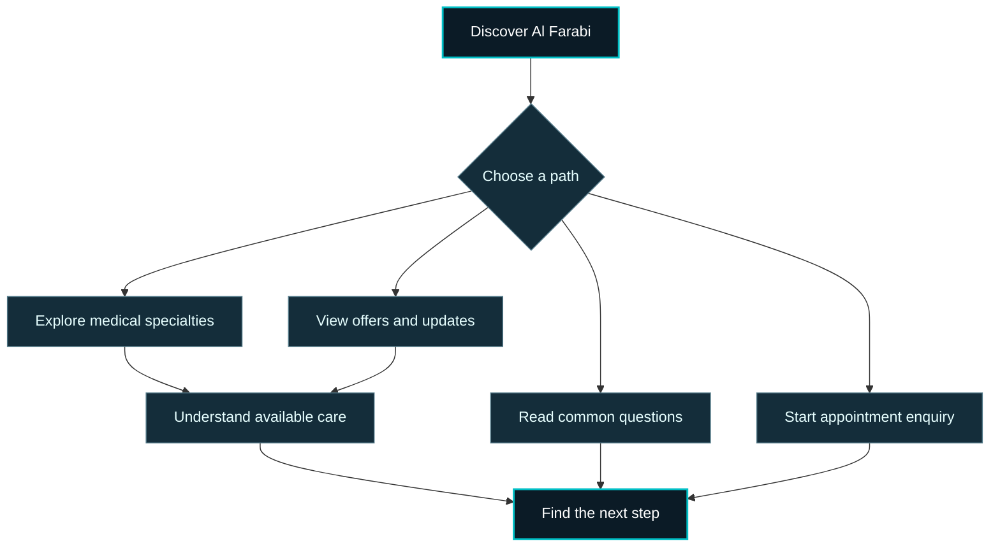

<!--
  AL FARABI MEDICAL CENTRE — PUBLIC PROJECT CASE STUDY
  Portfolio presentation only. No website source code, database content,
  application credentials, client documents, or internal infrastructure.
  Uses GitHub-supported Markdown/HTML and a Mermaid experience map.
-->

  <strong>V A L O 2 &nbsp; / &nbsp; S E L E C T E D &nbsp; W O R K</strong>

  <h1>AL FARABI MEDICAL CENTRE</h1>

  
<strong>Healthcare Website &nbsp;·&nbsp; Bilingual Digital Experience &nbsp;·&nbsp; Patient-Focused Design</strong>

  <h3>A more thoughtful way to discover healthcare.</h3>

  
تجربة رقمية مصممة لتسهيل استكشاف الخدمات الطبية والتخصصات ومعلومات المركز.

  

    
    
  

  
PROJECT CASE STUDY &nbsp;·&nbsp; UAE &nbsp;·&nbsp; PRESENTED BY <a href="https://github.com/Tammam-Bacheir"><strong>TAMMAM BACHEIR</strong></a>

---

## 01 — The Project

**Al Farabi Medical Centre** is a healthcare website created to communicate the medical centre's identity and make essential information easier for visitors to explore. Its digital experience brings together medical specialty discovery, service-oriented navigation, appointment calls to action, patient guidance, and frequently asked questions within a distinctive bilingual interface.

The experience is built around a simple idea: **people looking for healthcare information should be able to orient themselves quickly, understand their options, and identify a clear next step.**

> **Project direction**  
> A considered healthcare experience — where visual identity, clarity of information, and purposeful navigation work together.

**Industry:** Healthcare & Medical Services  
**Project type:** Client Website / Digital Experience  
**Presentation languages:** Arabic & English  
**Agency:** VALO2 Agency  
**Project lead:** Tammam Bacheir — Founder & Director, VALO2 Agency

---

## 02 — Experience at a Glance

### A distinctive first impression

The homepage introduces the medical centre through a bold full-screen visual composition, a deep midnight palette, turquoise accents, and a strong typographic focal point. Primary entry points invite visitors to **explore services**, **start an appointment enquiry**, or **discover current offers**.

The navigation uses a concise menu and visible language control, allowing the public-facing experience to present content in both Arabic and English.

### Medical specialties, easier to discover

A dedicated specialty-discovery area organizes medical departments as choices visitors can explore before taking their next step. The visible interface presents categories including:

- Orthopedics and physical therapy
- Ear, nose & throat (ENT)
- Cardiovascular care
- Pediatrics and dentistry
- Nutrition
- Obstetrics & gynecology
- Dermatology and aesthetic care

The design prioritizes a clear hierarchy between the available departments and the information relevant to each selection.

### A guided patient journey

The website also introduces the patient experience through a **step-oriented, healthcare-themed presentation**. Medical iconography, an ECG-inspired progress line, and focused copy turn an otherwise complex subject into a sequence visitors can understand at a glance.

Rather than overwhelming the visitor with every detail simultaneously, the section emphasizes orientation and reassurance through visual structure.

### Questions answered through a visual interface

The frequently asked questions area takes an unusual approach: a **circular, icon-led composition** with a central information panel. The distinctive radial layout gives a familiar FAQ section its own visual identity while keeping the purpose straightforward — helping visitors find useful information.

### Offers and membership communication

Selected sections of the website also surface promotional and membership-related messaging. These are presented as **visitor-facing communications**, complementing the service and appointment pathways without making the website feel like a general-purpose e-commerce storefront.

---

## 03 — Visitor Experience Map

A simplified overview of the public-facing journey represented by the website:

**Experience priorities**

- **Discoverability** — make the centre's main offerings easy to locate.
- **Clarity** — guide visitors through medical topics without unnecessary complexity.
- **Language accessibility** — make information available in Arabic and English.
- **Direction** — provide visible paths from discovery toward an enquiry or contact action.
- **Consistency** — maintain one recognizable digital identity throughout the journey.

---

## 04 — Design Language

The website adopts a restrained, recognizable visual system rather than a conventional bright-white medical template.

**01 / Midnight foundation**  
Deep navy and near-black surfaces establish a calm, premium visual base and give the content room to breathe.

**02 / Turquoise illumination**  
Cyan and turquoise highlights draw the eye toward active elements, section headings, and important actions.

**03 / Medical symbolism**  
ECG-inspired lines, healthcare icons, and circular forms connect the interface with the centre's field without overloading the page with decorative imagery.

**04 / Editorial hierarchy**  
Large headings, carefully spaced content blocks, and clear action labels help visitors scan each section and understand the purpose of the page.

**05 / Bilingual identity**  
The interface accommodates Arabic and English presentation, with navigation and content arranged to serve visitors across language contexts.

> **Design principle:** Let the interface feel refined and memorable, while keeping the information people came for at the center of the experience.

---

## 05 — What the Website Brings Together

<strong>Explore the website's public-facing feature areas</strong>

### Homepage & entry points

- Medical centre introduction and branded hero experience.
- Direct visual paths toward service information, appointment enquiries, and offers.
- Concise navigation and language-selection controls.

### Services & specialty discovery

- Categorized medical specialty presentation.
- Department-oriented browsing experience.
- Clear prompts to continue exploring the selected area of care.

### Patient-facing information

- Step-based patient journey communication.
- Healthcare-themed information layout.
- Frequently asked questions presented through a visual, icon-led composition.

### Digital communication

- English and Arabic content presentation.
- Offers and membership-related public messaging.
- Clearly identifiable enquiry and next-step actions.

---

## 06 — My Contribution

### From concept to a cohesive digital experience

**Tammam Bacheir**  
Founder & Director — **VALO2 Agency**

My work on the Al Farabi Medical Centre website focused on translating the project's goals into a cohesive digital presentation: **website development, interface direction, content organization, visual consistency, and visitor-oriented navigation**.

The intention was not simply to publish information online, but to create a recognizable healthcare website where users can move from first impression to service discovery with greater confidence.

The result is presented here as a **client project case study** — focusing on the public-facing product and the design and development contribution behind it.

---

## 07 — Project Presentation & Confidentiality

This repository is a **public portfolio showcase**, not the application's source-code repository.

The website's source code, backend implementation, databases, credentials, client information, internal configuration, and proprietary technical materials are **not published here**.

The case study describes the visible website experience and its product direction. Any future public demonstrations or additional project materials can be added separately with the appropriate permissions.

---

  <h2>Explore the Experience</h2>

  
<strong>Discover the medical centre's digital presence.</strong>

  

    
    
    
  

  
<strong>AL FARABI MEDICAL CENTRE</strong> &nbsp;·&nbsp; Digital Experience by <strong>VALO2 Agency</strong>

  
Project showcase by <a href="https://github.com/Tammam-Bacheir">Tammam Bacheir</a>

